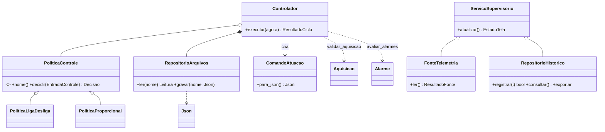

# Projeto final POO — planta, controlador C++ e supervisório Streamlit

Cenário: **tanque** com nível (`LT-01`, `%`) e temperatura (`TT-01`, `C`), atuadores **bomba** e **aquecedor** (0–100 %).
Três processos locais, comunicação por JSON com **escritor único por arquivo**.

> **Estado desta entrega:** este código foi escrito a partir do `AGENTS3.md`, **sem acesso ao repositório real**
> (`planta/simulador.py`, `Makefile`, `docs/CONTRATO.md`, CI). Veja "Pendências a confirmar" antes de integrar.
> Nada aqui declara o projeto "pronto" ou "aprovado": isso depende de revisão, CI e defesa da dupla.

## 1. Cenário, objetivo e limites

| Item | Definição |
|---|---|
| Problema | manter o tanque com nível e temperatura próximos de alvos, sem agir com dado inválido ou antigo |
| Grandezas | `LT-01` nível (`%`, faixa 0–100) · `TT-01` temperatura (`C`, faixa 0–100, limites didáticos) |
| Atuadores | `bomba` e `aquecedor`, percentual em [0,100] |
| Objetivo de controle | nível → 60 %, temperatura → 40 °C |
| Estados | operação normal · operação degradada (um sensor em falha) · estado seguro (0 %/0 %) por aquisição obsoleta · sem aquisição |
| Alarmes | `NIVEL_BAIXO` (nível **<** 20), `TEMPERATURA_ALTA` (temperatura **>** 80), `FALHA_SENSOR_<TAG>`, `AQUISICAO_OBSOLETA` |
| Limites do modelo | a planta é uma aproximação didática (bomba +3 pt/ciclo, consumo −1, aquecedor +1,5 °C, relaxamento 4 % para 20 °C, ruído pequeno); não é modelo físico calibrado |

Alarmes: igualdade ao limite **não** alarma (fronteira estrita). Um alarme some quando uma aquisição **nova** (sessão/ciclo novo) traz leitura válida; não depende de o arquivo "voltar a existir". Alarme não é persistido como evento: o histórico guarda os códigos ativos de cada aquisição.

## 2. Arquitetura

| Processo | Linguagem | Faz | Não faz |
|---|---|---|---|
| Planta (fornecida) | Python | simula estado e resposta aos atuadores | escolher ações |
| Controlador (`controlador/`) | C++17 | valida aquisição, aplica política, comanda, emite telemetria | tela, medições aleatórias |
| Supervisório (`supervisorio/`) | Python + Streamlit | valida telemetria, apresenta, registra histórico em SQLite, exporta CSV | recalcular política, escrever na entrada da planta |

| Arquivo | Escreve | Lê |
|---|---|---|
| `dados/planta.json` | planta | controlador |
| `dados/comando_planta.json` | controlador | planta |
| `dados/telemetria.json` | controlador | supervisório |
| `dados/controlador_estado.json` | controlador | controlador |
| `dados/historico.sqlite` | supervisório | supervisório |

Escrita: JSON completo em `<arquivo>.tmp` no mesmo diretório e `rename` (atômico em sistema de arquivos local POSIX; sem transação entre arquivos e sem garantia de durabilidade em queda). Snapshots podem perder ciclos: o histórico registra o que o supervisório **viu**, não afirma ausência de perdas.

## 3. Dependências e execução

- Linux/WSL, GNU Make, **g++ com C++17**, Python 3.12+. Nenhuma biblioteca C++ externa: o JSON é tratado por `controlador/json.{hpp,cpp}` (analisador próprio, sem regex), porque `nlohmann/json` não estava disponível no ambiente de desenvolvimento. Se a dupla preferir `nlohmann/json`, só `json.*`, `repositorio.cpp`, `aquisicao.cpp` e `controlador.cpp` usam a classe `Json`.
- Python: `streamlit>=1.37` (usa `st.fragment(run_every=...)`). Acrescente a `requirements-dev.txt`.

```bash
python3 -m venv .venv && .venv/bin/python -m pip install -r requirements-dev.txt
make -f autoral.mk controlador               # gera build/controlador (ou o alvo equivalente do Makefile do repositório)

python3 -m planta.simulador --dados dados --passos 0 --intervalo 1 --seed 7     # terminal 1 (planta)
build/controlador --dados dados --politica proporcional --intervalo 1           # terminal 2 (controlador)
POO_DADOS=dados .venv/bin/streamlit run supervisorio/app.py                     # terminal 3 (supervisório)
```

Parâmetros do controlador (CLI): `--dados DIR` (ou `POO_DADOS`), `--politica liga-desliga|proporcional`, `--uma-vez`, `--intervalo S`, `--limite-obsoleto S` (padrão 10). Saída: 0 ok; 1 erro de execução; 2 entrada inválida/indisponível (`--uma-vez`); 64 uso incorreto. Supervisório: `POO_DADOS`, `POO_BANCO`, `POO_LIMITE_OBSOLETO` (padrão 10 s).

Não execute `tools/enviar_comando.py` junto com o controlador (dois escritores em `comando_planta.json`).

## 4. Contratos (resumo; a fonte de verdade é `docs/CONTRATO.md`)

- **Aquisição**: `versao`=1 (inteiro; booleano não vale), `sessao`, `ciclo`>0, `timestamp` UTC `AAAA-MM-DDTHH:MM:SSZ`, `leituras[{tag,tipo,valor,unidade,status}]`, `atuadores{bomba,aquecedor}`, `ultimo_comando`, `erro_comando`, `motivo_seguro`.
- **Comando**: `{versao:1, sessao, id, atuadores:{bomba, aquecedor}}`; no máximo **um comando por aquisição**, `id = max(último id emitido, ultimo_comando da planta) + 1`.
- **Telemetria**: campos da aquisição copiados sem alteração + `alarmes[{codigo,mensagem,severidade}]` + campo extra `controlador` (política, `solicitacao` futura com `id`, `confirmacao{id,estado}`, `aquisicao_obsoleta`, `gerado_em`). Atuação **observada** (`atuadores`) nunca é misturada com a **solicitada** (`controlador.solicitacao`).
- **Confirmação**: no ciclo seguinte, `ultimo_comando >= id pendente` ⇒ `confirmado`; `erro_comando` presente ⇒ `rejeitado`; caso contrário `pendente`.
- **Falhas por sensor** (grandezas independentes; uma não substitui a outra): `LT-01` inválido ⇒ bomba 0; `TT-01` inválido ⇒ aquecedor 0; a outra grandeza segue controlada. Documento inteiro inválido ⇒ rejeitado, diagnóstico, saída ≠ 0 e **telemetria/comando anteriores intocados**.
- **Obsolescência**: idade = agora − `timestamp` > **10 s** (padrão; igual ao limite não é obsoleta). Obsoleta ⇒ política **não** é usada (estado seguro 0 %/0 %, motivo `aquisicao_obsoleta`) e alarme `AQUISICAO_OBSOLETA`. É decisão diferente do timeout de 5 **ciclos** da planta. O timestamp tem resolução de 1 s.
- **Recuperação**: o controlador relê `planta.json` a cada ciclo; ao voltar um documento válido com sessão/ciclo novo, retoma com id novo. Estado do controlador corrompido ⇒ diagnóstico e reinício do estado (ids continuam > `ultimo_comando`). O supervisório relê a cada 2 s; telemetria inválida ⇒ mostra erro e o último registro do histórico **marcado como antigo**.
- Sessão nova (planta reiniciada) ⇒ controlador abandona ciclo/ids anteriores.

## 5. Política (Strategy) e padrões

Interface `PoliticaControle::decidir(EntradaControle) -> Decisao` (pura: sem estado, arquivo ou aleatoriedade).

| Estratégia | Regra | Exemplo (nível 55, temp 38) |
|---|---|---|
| `liga-desliga` | 100 % se medida < alvo, senão 0 % | bomba 100, aquecedor 100 |
| `proporcional` | `clamp(ganho·(alvo−medida), 0, 100)`; ganhos 5 %/pt e 10 %/°C | bomba 25, aquecedor 20 |

Parâmetros e justificativa (escolhas de engenharia, não derivados de dados pessoais): alvo de nível 60 % (longe do alarme de 20 %); alvo de temperatura 40 °C (alcançável: acima de 20 °C, com folga do alarme de 80 °C); ganho 5 satura a bomba com erro ≥ 20 pt; ganho 10 satura o aquecedor com erro ≥ 10 °C. Consequência conhecida do controle proporcional puro: **erro em regime** (com a dinâmica descrita, nível ≈ 53 % e temperatura ≈ 36 °C); o liga-desliga oscila em torno do alvo. A escolha entre políticas é do operador (`--politica`); o padrão é `proporcional` por não chavear bruscamente.

| Padrão | Problema resolvido | Classes | Testes | Alternativa mais simples |
|---|---|---|---|---|
| **Strategy** | trocar a regra de decisão sem alterar o ciclo do controlador | `PoliticaControle`, `PoliticaLigaDesliga`, `PoliticaProporcional`, `Controlador` | `autorais_politica_comando_alarmes`, `autorais_controlador::duas_politicas_...` | `if/else` sobre um enum dentro de `Controlador` (menos testável isoladamente) |
| **Repository** | isolar o acesso aos JSON (leitura tri-estado ok/ausente/inválido, escrita atômica) para testar com diretório temporário | `RepositorioArquivos` (C++), `RepositorioHistorico` e `FonteTelemetria` (Python) | `autorais_repositorio`, `autorais_historico.py`, `autorais_servico.py` | funções soltas de `fopen/rename` espalhadas |

`ComandoAtuacao` é objeto de valor que protege a invariante (id>0, percentuais finitos em [0,100]); não é apresentado como padrão.

## 6. Diagrama de classes



`supervisorio/app.py` só chama `st.*` e o `ServicoSupervisorio`; nenhuma regra ou acesso a arquivo/banco fica nele.

## 7. Persistência e exportação

SQLite `aquisicoes`, chave primária `(sessao, ciclo)`; `INSERT OR IGNORE` ⇒ rerun da tela não duplica; histórico sobrevive a reiniciar a tela. Leitura inválida é gravada como `NULL` (gráfico mostra lacuna), nunca como valor anterior. CSV exportado contém exatamente os registros consultados (filtro de sessão e limite da barra lateral), com cabeçalho mesmo se vazio.

## 8. Testes

```bash
make -f autoral.mk test        # C++ (tests/cpp/autorais_*.cpp) + Python (tests/autorais_*.py)
make test                      # alvo do repositório (cumulativo); make test ETAPA=NN por etapa
make cobertura PYTHON=.venv/bin/python
```

Resultado local nesta entrega (g++ 13.3, Python 3.12): 5 executáveis C++ OK, 50 testes Python OK (incluindo `autorais_caminho_completo`, que compila o controlador e usa `python -m planta.simulador`). Foi feita verificação por **mutação manual** (trocar `<` por `<=` em política e alarme, `>` por `>=` na obsolescência, desligar a proteção de ciclo repetido, afrouxar a faixa 0–100, usar política com dado obsoleto): cada mutação foi detectada por pelo menos um teste. **Cobertura (`make cobertura`) não foi executada**; analise `build/relatorios/*` e preencha as lacunas na matriz.

### Matriz de testes (objeto/método × requisito × caso)

| Objeto/método | Requisito | Caso | Entrada → resultado esperado | Teste | Lacuna |
|---|---|---|---|---|---|
| `Json::analisar/serializar` | JSON sem regex, int≠real≠bool | comum/fronteira/falha | `1`→inteiro, `1e2`→real, `true` não é número; `NaN`, `[1,]`, `1e999` → `ErroJson` | `autorais_json_tempo` | — |
| `analisar_utc/formatar_utc` | timestamp UTC estrito | comum/fronteira/falha | `2024-02-29T12:00:00Z`→1709208000; `2023-02-29…`, `T24:00`, sem `Z` → falso, saída intacta | `autorais_json_tempo` | fuso/segundo bissexto fora de escopo |
| `validar_aquisicao` | validar documento e por leitura | comum | documento válido → `ok`, nível 55,5, temperatura 30 | `autorais_aquisicao::comum` | — |
| `validar_aquisicao` | faixa [0,100] | fronteira | 0 e 100 válidos; 100,0001 e −0,0001 rejeitam só a leitura | `autorais_aquisicao::fronteira` | — |
| `validar_aquisicao` | tipo/unidade/status/valor | falha | unidade/tipo trocados, valor texto/booleano/nulo, `falha`, status desconhecido, tag ausente → só aquela grandeza sem valor + `FALHA_SENSOR_*` | `autorais_aquisicao::falha_por_sensor` | — |
| `validar_aquisicao` | contrato do envelope | falha | versão 2/`true`/1.0, sessão vazia, ciclo 0/4.0, timestamp ruim, tag duplicada, raiz não objeto → `!ok` com erros | `autorais_aquisicao::rejeicao_do_documento` | — |
| `PoliticaLigaDesliga/Proporcional::decidir` | duas estratégias distintas | comum | (55, 38) → 100/100 vs 25/20 | `politicas_decisoes_diferentes` | — |
| idem | limites e saturação | fronteira | medida == alvo → 0 nas duas; 59,999 liga; erro 300 satura em 100 | `politicas_fronteiras` | — |
| idem + `criar_politica` | operação degradada e parâmetros | falha | sem LT-01 → bomba 0; sem TT-01 → aquecedor 0; alvo 101/ganho 0 → `invalid_argument` | `politicas_falha_e_estado_seguro` | — |
| `ComandoAtuacao` | invariante do comando | comum/fronteira/falha | 0 e 100 aceitos; 100,1, −0,1, id 0, sessão vazia, NaN → `invalid_argument` | `comando` | — |
| `avaliar_alarmes` | 2 alarmes com fronteira | comum/fronteira | nível 20 e temp 80 não alarmam; 19,999 e 80,001 alarmam; obsoleta/ falha de sensor distintos | `alarmes` | — |
| `RepositorioArquivos` | escrita atômica e leitura tri-estado | comum/fronteira/falha | gravar→ler; substituição completa; ausente, truncado, vazio, `NaN` → estados corretos; diretório inexistente lança e preserva destino | `autorais_repositorio` | falha de `rename` por permissão não simulada |
| `Controlador::executar` | emissão e confirmação | comum | ciclo 1 → id 1 (25/20); ciclo 2 → `confirmado`; sem acompanhar → `pendente`; `erro_comando` → `rejeitado` | `ciclo_completo_e_confirmacao` | — |
| `Controlador::executar` | não renovar ao reler ciclo | falha/fronteira | mesmo ciclo, reinício do processo → sem comando novo, arquivo intacto; ciclo menor ignorado | `nao_renova_ao_reler_ciclo` | — |
| `Controlador::executar` | reinício de sessão | falha | sessão nova → id volta a 1, sem herdar confirmação | `reinicio_de_sessao` | — |
| `Controlador::executar` | arquivo ausente/JSON inválido/contrato | falha | diagnóstico, ≠0, telemetria e comando anteriores intactos; recupera com id novo | `falhas_de_entrada_preservam_telemetria` | — |
| `Controlador::executar` | falha de sensor e recuperação | falha/comum | TT-01 em falha → aquecedor 0, nível controlado, alarme; LT-01 em falha → bomba 0; alarmes somem com leitura nova | `falha_de_sensor_e_recuperacao` | falha de aquisição geral × sensor separados só em parte |
| `Controlador::executar` | obsolescência | fronteira/falha | idade==limite usa política; >limite alarma sem novo comando; ciclo novo antigo → 0/0 | `obsolescencia` | — |
| `Controlador::executar` | estado persistido | falha | `controlador_estado.json` corrompido → diagnóstico e segue | `estado_do_controlador_invalido_recupera` | — |
| `validar_telemetria` | contrato da telemetria | comum/fronteira/falha | válida; atuador 0/100 ok, 100,01 não; booleano ≠ inteiro; campo ausente; NaN | `autorais_telemetria.py` | — |
| `idade_segundos/analisar_timestamp` | idade da aquisição | comum/fronteira/falha | 7 s; 0 s e relógio atrasado → 0; formatos próximos rejeitados | `autorais_telemetria.py::Idade` | — |
| `valor_da_leitura` | leitura inválida não vira medição | falha | `falha` → `None`; outra grandeza intacta | `autorais_telemetria.py::ValorDaLeitura` | — |
| `RepositorioHistorico` | SQLite sem duplicar | comum/falha | mesmo (sessão,ciclo) → `False`, 1 registro, primeiro valor preservado; reabrir banco | `autorais_historico.py` | concorrência de dois processos |
| `RepositorioHistorico.consultar` | consulta | fronteira/falha | limite 2 → 2 mais recentes em ordem; banco vazio; limite 0 → `ValueError` | `autorais_historico.py` | — |
| `exportar_csv` | CSV dos dados consultados | comum/fronteira | só os registros consultados; vazio → cabeçalho; nulo → célula vazia | `autorais_historico.py::ExportarCsv` | — |
| `ServicoSupervisorio.atualizar` | idade, obsolescência, recuperação | comum/fronteira/falha | idade 3 s; ==limite não obsoleta; ausente/inválido/NaN/contrato violado não entram; recupera; sessão nova cria registro | `autorais_servico.py` | — |
| caminho completo | planta → telemetria → tela | comum/falha | planta real (3 ciclos) → controlador → serviço: origem preservada, registro e CSV; reler ciclo; sessão nova; `planta.json` truncado → saída 2 | `autorais_caminho_completo.py` | usa a planta do repositório; execução simultânea contínua só verificada manualmente |
| `app.py` (Streamlit) | tela com leituras, atuação, confirmação, alarmes, idade, gráficos, CSV | — | — | — | sem teste automatizado; só um *smoke test* com `streamlit` substituído por stub (percorre o fluxo sem erro de nome), **nunca rodou no Streamlit real** (indisponível aqui); a lógica testável está em `servico.py` |

## 9. Divisão de trabalho, Git e entrega

**A preencher pela dupla** (não inventado aqui): integrantes, fork de entrega, quem fez cada módulo, como as contribuições foram reunidas. Fluxo exigido: fork próprio, só `origin`, PR para a `main` do próprio fork, branches `projeto/00…04`, `ETAPA_ATUAL` atualizado, revisão cruzada. Sugestão de mapeamento: `projeto/01-aquisicao` ← `json`, `tempo`, `aquisicao`, `repositorio` + testes; `02-controle` ← `politica`, `comando`, `alarmes`, `controlador`, `main` + testes; `03-supervisor` ← `supervisorio/` + testes Python.

## 10. Pendências a confirmar no repositório real

1. Formato real de `atuadores` em `planta.json` (assumido `{"bomba":x,"aquecedor":y}`, como no comando) e de `motivo_seguro` (aceito qualquer texto ou `null`; o AGENTS3 aponta `sem_comando` na planta contra `sem_arquivo/…` no contrato).
2. Alvos do `Makefile`: se ele compila `controlador/*.cpp` (exceto `main.cpp`) e descobre `tests/cpp/autorais_*.cpp`; `teste_util.hpp` e `dados_teste.py` são auxiliares (não são testes). `make supervisor` deve apontar para `supervisorio/app.py`.
3. Valores de tags/unidades/faixas em `docs/CONTRATO.md`; prazo de obsolescência (10 s) é escolha desta entrega: ajuste e justifique.
4. Rodar `make cobertura`, interpretar `build/relatorios/{cpp,python}/index.html` e registrar lacunas.
5. Executar o Streamlit real (`app.py` só foi exercitado com stub) e conferir a API da sua versão (`st.fragment`).

## 11. Limitações conhecidas

Analisador JSON próprio (sem suporte a números fora de `double`/`long long`, profundidade 64); controle proporcional com erro em regime; `AQUISICAO_INDISPONIVEL` (arquivo ausente/ilegível) vira diagnóstico do controlador e obsolescência da telemetria no supervisório, não alarme em `telemetria.json` (o controlador não inventa aquisição); histórico só contém o que o supervisório leu; sem TCP, hardware, nuvem ou autenticação (não exigidos).
